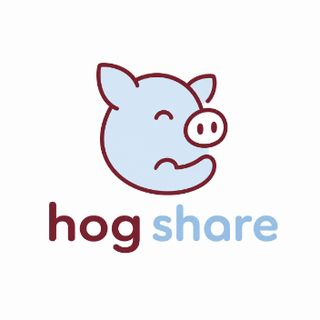
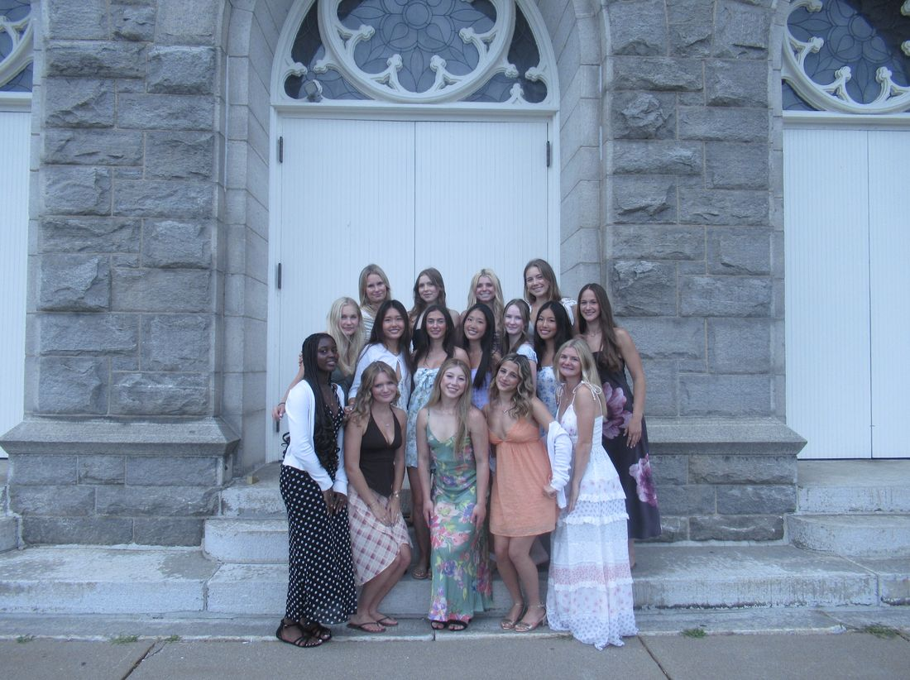
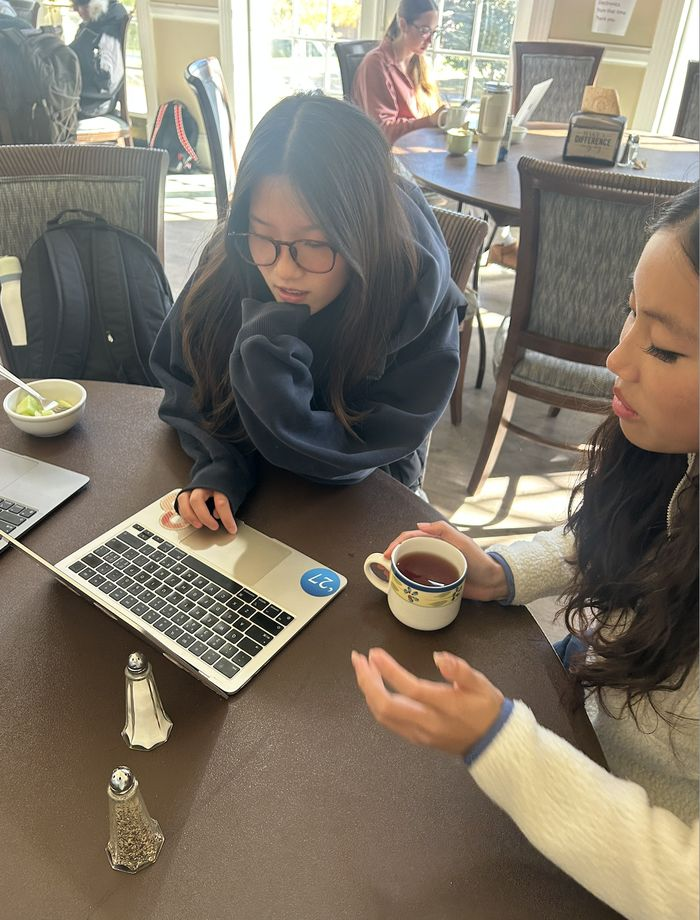

  
  <h1>Hogshare</h1>
  
<a href="https://www.instagram.com/nmh.hogshare/">@nmh.hogshare</a>

---

## Team Intro

The founders of Hogshare are Katie Hu'27 and Tina Wu'27, creating the project in their Social Entrepreneurship II class. We built this because we noticed firsthand the demand for borrowing—whether it's friends asking each other or hearing "I don't have anything to wear" when closets are overflowing and cabinets cannot close. Everyone loves new things, but what if we created a solution to combine the love for new items for $0 while helping the environment? 

Introducing **Hogshare**!

---

## The Problem: Pay More, Use Less

NMH students regularly encounter a recurring and inefficient cycle of consumption. Before major campus events like Dwight Night, athletic banquets, and formal dances, students often spend $70 or more on items like dresses and accessories that are worn only once. Similarly, students seeking weekend entertainment frequently make impulsive purchases of recreational goods such as sports equipment or gaming consoles only for the items to be left alone shortly after. 

> *"I sometimes really don't want to spend that much on a new costume, but there's no way I'm re-wearing my old ones, so I guess I have to."*  
> — Initial student interviewee

Not only is this one-time-use consumption making students pay more, but it also creates excessive waste on campus. This leads to negative environmental impacts, as many one-time-use plastics and fabrics cause severe environmental harms and take decades to degrade.

*Dresses (example of items that could be worn and shared multiple times)*

According to our user survey:
* **>80%** of respondents wanted something for an event but didn't buy it because of its price.
* **37%** of respondents reported having a habit of borrowing items from others.

Students who require temporary access to items currently have no reliable or structured method for doing so beyond informal peer-to-peer requests. There is no existing system that creates a mutually beneficial exchange between students with inactive assets and students seeking short-term access. Students want to regain some of their initial investment, and students seeking affordable, temporary access to goods need an efficient way to find them.

---

## Our Mission: A Circular System Built for NMH

Hogshare's purpose is to bridge this gap for both sides. We provide a solution that combines convenience, affordability, and sustainability within a single on-campus platform. 

As a social enterprise, Hogshare empowers students to lend and borrow clothing, dresses, themed costumes, accessories, sports gear, textbooks, and recreational equipment directly from one another. By shifting our campus culture from single-use ownership to shared access, Hogshare reduces waste, builds transparency and trust, and strengthens sustainability awareness across our student body.

---

## The Hogcash System: Free Borrowing & Earning Rewards

Students can borrow items for **FREE** and even earn value through transactions using **Hogcash**, an internal credit system (1 Hogcash = $1 in rental value).

* **Earn Hogcash:** Volunteer in campus sustainability events and commit to environmentally friendly actions in return for platform credit. Examples include donating clothing, attending sustainability events, or leaving comments on Hogshare.
* **Borrow What You Need:** Rent any item listed on Hogshare using your earned Hogcash credits.
* **Make Value Out of Hogshare:** Register and list your own items. Whenever your item is rented out, the transaction value converts into available credits for the school store during cashout timeframes. *(Example: If someone pays 5 Hogcash to borrow your hair curler, you get $5 in school store credits).*

---

## Platform Comparison

| Feature | Traditional Retail / Online Buying | Hogshare Platform |
| :--- | :--- | :--- |
| **Upfront Cost** | High ($70+ per single-use item) | **$0 Cost** (Volunteering & eco-tasks) |
| **Environmental Impact** | High textile waste & packaging pollution | **Zero waste** & circular economy |
| **Unwanted Item Treatment** | Unused in room or cheap one-time resale | **Rent out & earn ongoing school store credits** (Keep item ownership) |
| **Community Action** | None | **Incentivizes active campus sustainability** |

---

## Progress So Far

### Website Prototype
* [My Movie 27.mp4](https://drive.google.com/file/d/1n0TmOArrzh1XWz3ofIiA-UiC1OdJ0LqE/view)

Over the past two months, we designed and built a functioning website for all Hogshare activities, focusing on user experience, navigateability, and practical functionality.

### Core Features
1. **User Registration & Liability Form:** Users sign up with their NMH email. Includes Google email verification access for safe password resets via Softr. Requires agreement to our liability form (return responsibility, lost/damaged item policy, photo documentation, and community etiquette).
2. **Item Listings:** Browse published items filtered by condition, category, and name. Users list items with pricing, description, condition notes, and actual photos.
3. **Send Request:** Borrowers select item dates, estimated pricing, and purpose. Renters instantly receive approval/decline notifications. Upon approval, users connect via email to arrange campus pickup/return.
4. **Financial Analytics:** User dashboard displays statistical analytics of transaction history (pie charts, bar graphs) broken down by category and type, alongside active requests and pending approvals.

---

## Research & Feedback

* **Focus Group Testing:** Conducted cluster randomization focus group testing to gather feedback on website functionality and liability terms.
* **SWOT Analysis:** Analyzed Rent the Runway, Poshmark, and Neighborgoods to leverage industry strengths and avoid common operational risks.
* **Campus Survey:** Distributed via student announcements to identify demand and address key concerns—leading directly to cleanliness and accountability standards in our liability form.

---

## Marketing & Social Media

Follow our Instagram for news, Hogcash earning opportunities, and event updates:  
[**@nmh.hogshare**](https://www.instagram.com/nmh.hogshare/)

---

## Conclusion

Every item borrowed on Hogshare is one less item manufactured, shipped, and thrown away. Every student who lists an item turns an unused asset into shared value while earning credits for themselves. 

We built Hogshare to foster campus sustainability and strengthen the NMH community. Follow along at [@nmh.hogshare](https://www.instagram.com/nmh.hogshare/) and get ready to be part of a greener NMH!

---

**Tina Wu '27 & Katie Hu '27** · [@nmh.hogshare](https://www.instagram.com/nmh.hogshare/)
